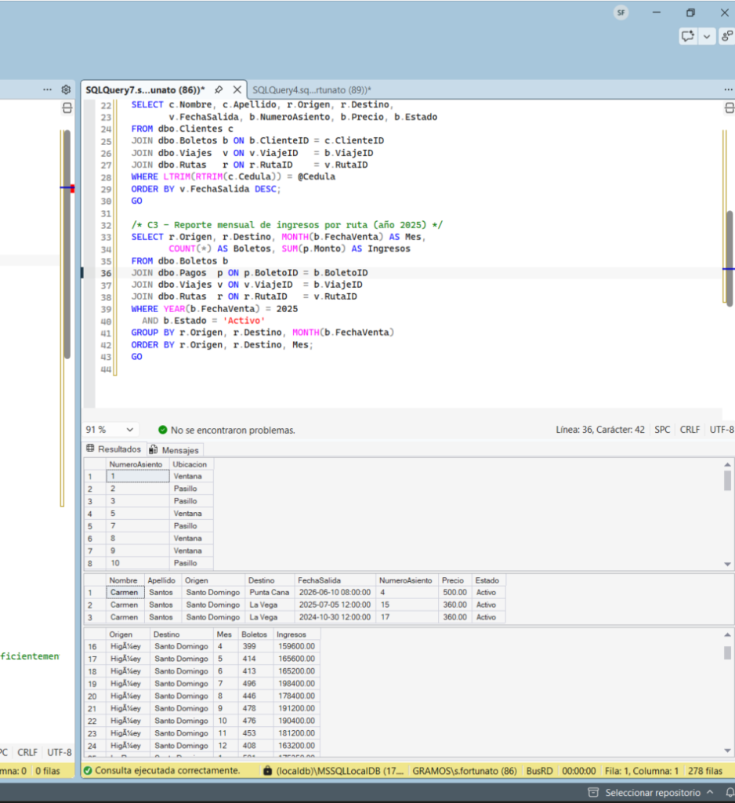
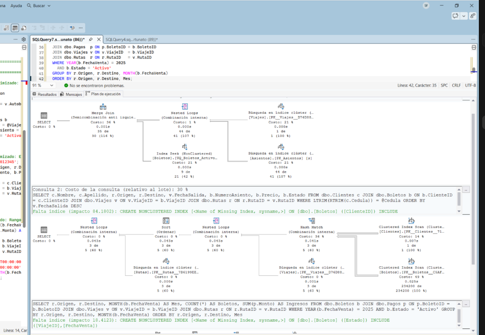
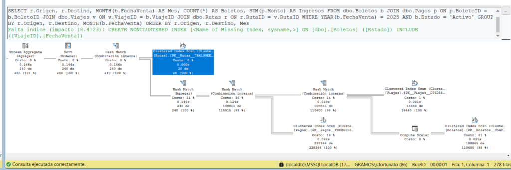
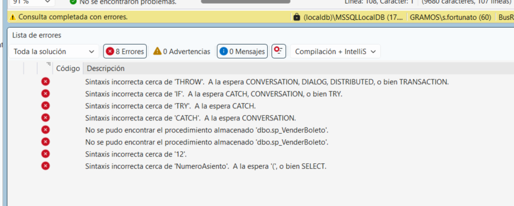
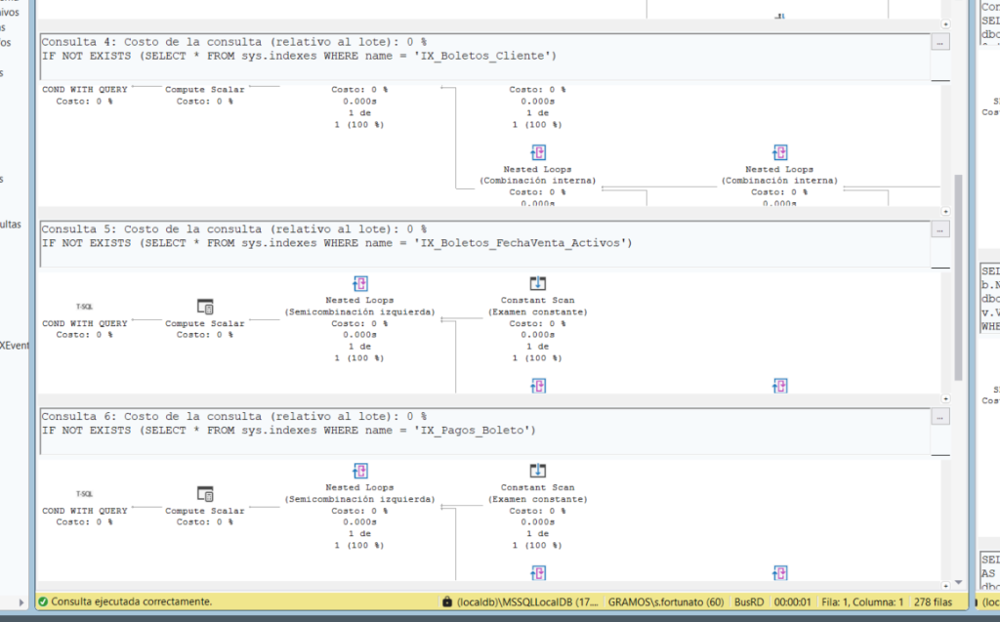
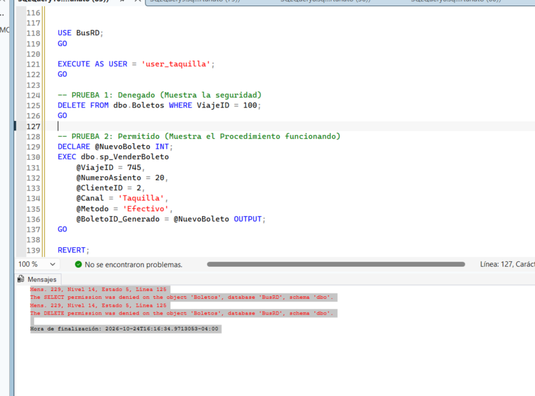
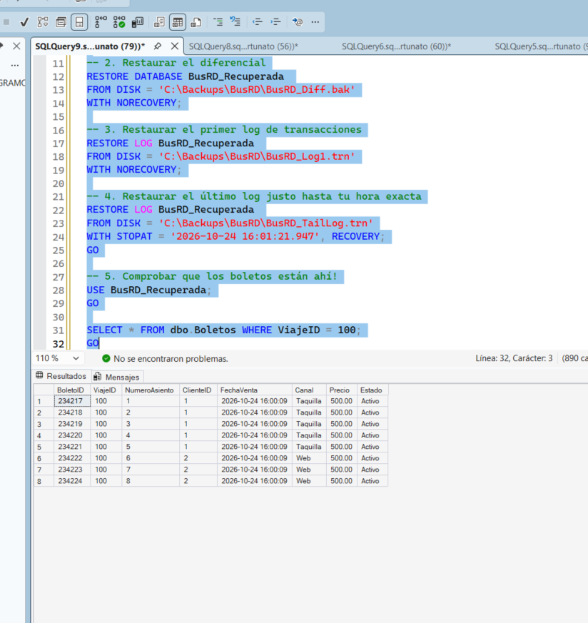

# Documentación Técnica del Proyecto BusRD

A continuación se detalla la justificación técnica y el código clave implementado en este proyecto para cumplir con los requisitos del taller.

## 1. Integridad de Datos Avanzada

Para evitar inconsistencias graves, como que se venda un asiento que ya está ocupado, implementamos restricciones estructurales y un Trigger de tipo `INSTEAD OF INSERT`. Decidimos usar un Trigger para tener una última línea de defensa a nivel de base de datos en caso de que alguien intente hacer un `INSERT` directo saltándose la aplicación.

```sql
CREATE OR ALTER TRIGGER dbo.TR_Boletos_ControlAsientos
ON dbo.Boletos
INSTEAD OF INSERT
AS
BEGIN
    SET NOCOUNT ON;
    
    -- Verificamos si el asiento que se quiere insertar ya está registrado como 'Activo' en ese mismo viaje
    IF EXISTS (
        SELECT 1 
        FROM inserted i
        JOIN dbo.Boletos b ON i.ViajeID = b.ViajeID 
            AND i.NumeroAsiento = b.NumeroAsiento 
            AND b.Estado = 'Activo'
    )
    BEGIN
        RAISERROR ('Violacion de Integridad: El asiento ya esta ocupado para este viaje.', 16, 1);
        ROLLBACK TRANSACTION;
        RETURN;
    END

    -- Si pasa la validación, hacemos el insert normalmente
    INSERT INTO dbo.Boletos (ViajeID, NumeroAsiento, ClienteID, FechaVenta, Canal, Precio, Estado)
    SELECT ViajeID, NumeroAsiento, ClienteID, FechaVenta, Canal, Precio, Estado
    FROM inserted;
END;
`



```

## 2. Control de Concurrencia (Evitar Sobrevendidos)

En un entorno real de ventas, dos personas podrían intentar comprar el mismo boleto al mismo tiempo (Race Condition). Para solucionar esto en el Procedimiento Almacenado de ventas, utilizamos bloqueos pesimistas para asegurar el registro mientras se evalúa.

```sql
-- Evitamos la concurrencia usando UPDLOCK y HOLDLOCK.
-- UPDLOCK: Pone un bloqueo de actualización en la fila, impidiendo que otra transacción haga lo mismo simultáneamente.
-- HOLDLOCK: Mantiene el nivel de aislamiento Serializable, reteniendo el bloqueo hasta el COMMIT.

IF EXISTS (SELECT 1 FROM dbo.Boletos WITH (UPDLOCK, HOLDLOCK)
           WHERE ViajeID = @ViajeID
             AND NumeroAsiento = @NumeroAsiento
             AND Estado = 'Activo')
BEGIN
    THROW 50006, 'El asiento ya esta vendido.', 1;
END
`



``
Con esto garantizamos que la "Sesión B" tenga que esperar a que la "Sesión A" termine su transacción. Si "A" compra el boleto, "B" recibe un error inmediatamente después de que "A" termina.

## 3. Optimización de Consultas

Al tener una tabla de boletos que crece rápidamente, las consultas para buscar asientos disponibles empezaron a hacer "Index Scans" (escanear toda la tabla fila por fila), lo que es muy lento.
Creamos un índice Non-Clustered filtrado, que funciona como un "Índice Cubierto" para las búsquedas.

```sql
CREATE NONCLUSTERED INDEX IX_Boletos_Viaje_Activos 
ON dbo.Boletos (ViajeID, Estado) 
INCLUDE (NumeroAsiento)
WHERE Estado = 'Activo';
`

**Antes de optimizar (Index Scan):**


**Después de optimizar (Index Seek):**

``
De esta forma, la base de datos ya tiene un árbol de búsqueda ordenado por Viaje y Estado, e incluye el número de asiento en el propio índice para no tener que ir a buscarlo a la tabla física (Index Seek).

## 4. Seguridad de Acceso

Para la seguridad aplicamos el principio de menor privilegio usando roles y el concepto de "Ownership Chaining" (Encadenamiento de propiedad). 

```sql
-- Creamos el rol
CREATE ROLE rol_taquilla;

-- Le damos permiso SOLO para ejecutar el procedimiento de venta
GRANT EXECUTE ON dbo.sp_VenderBoleto TO rol_taquilla;

-- Le quitamos todo acceso directo a la tabla
DENY SELECT, INSERT, UPDATE, DELETE ON dbo.Boletos TO rol_taquilla;
`


``
Esto asegura que ni siquiera un empleado malintencionado que consiga acceso a la base de datos pueda hacer un `DELETE` directo en la tabla `Boletos`. Obligatoriamente tiene que pasar por el procedimiento almacenado que tiene nuestras validaciones.

## 5. Respaldo y Restauración (Point-In-Time Recovery)

Como estrategia de recuperación ante desastres, configuramos la base de datos en modelo de recuperación Completo (`FULL`) y preparamos scripts para hacer un *Point-In-Time Recovery* (PITR).

Si alguien borra registros por error, usamos el archivo de registro de transacciones (Tail-Log) para restaurar la base de datos exactamente al milisegundo antes de que ocurriera el accidente.

```sql
-- Restauración hasta el momento exacto (STOPAT)
RESTORE LOG BusRD_Recuperada 
FROM DISK = 'C:\Backups\BusRD\BusRD_TailLog.trn'
WITH STOPAT = '2026-10-24 16:01:21.947', RECOVERY;
`


``
