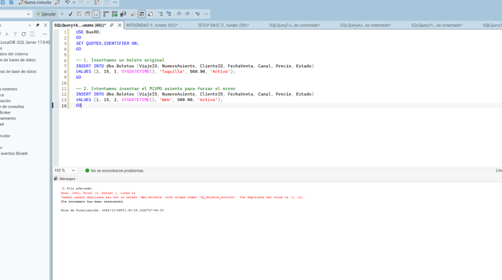
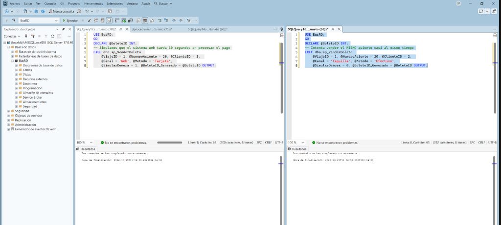
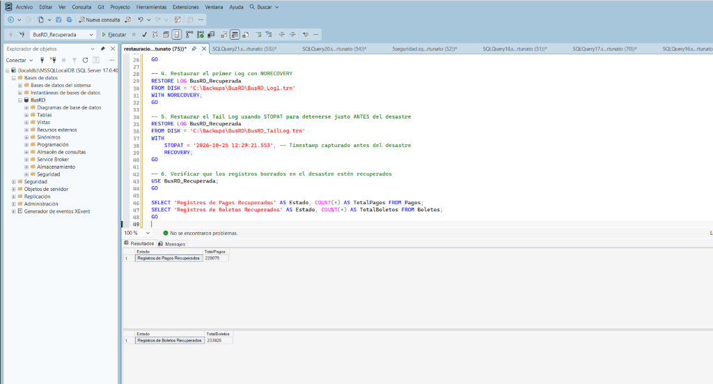

# Informe Técnico del Proyecto BusRD

**Grupo 5**
- MYNOR DIAZ - A00151859
- Sadel Fortunato - A00168805

---

## 1. Introducción
El presente informe documenta el desarrollo y la implementación del sistema transaccional **BusRD**, diseñado para gestionar la venta de boletos de autobuses en República Dominicana. El alcance del proyecto abarca el diseño robusto de la base de datos aplicando reglas de integridad, manejo seguro de concurrencia para prevenir sobreventas de asientos, optimización de consultas lentas mediante índices, un modelo de seguridad basado en el principio de mínimo privilegio y una estrategia sólida de respaldos y recuperación de desastres (Point-In-Time Recovery). 

Este documento sirve como evidencia de los conceptos de bases de datos avanzadas aplicados al entorno práctico.

---

## 2. Integridad
Durante el análisis inicial, detectamos datos sucios (registros huérfanos de boletos sin viaje correspondiente o viajes sin autobús). 
**Limpieza:** Se ejecutaron sentencias `DELETE` previas a la creación de las llaves foráneas para purgar los datos inconsistentes.
**Restricciones:** Se crearon restricciones `FOREIGN KEY` rigurosas. Adicionalmente, para asegurar la regla de negocio más crítica (unicidad de boletos activos), se implementó un Trigger `INSTEAD OF INSERT`:

```sql
CREATE OR ALTER TRIGGER dbo.TR_Boletos_ControlAsientos
ON dbo.Boletos
INSTEAD OF INSERT
AS
BEGIN
    SET NOCOUNT ON;
    IF EXISTS (
        SELECT 1 FROM inserted i
        JOIN dbo.Boletos b ON i.ViajeID = b.ViajeID AND i.NumeroAsiento = b.NumeroAsiento AND b.Estado = 'Activo'
    )
    BEGIN
        RAISERROR ('Violacion de Integridad: El asiento ya esta ocupado para este viaje.', 16, 1);
        ROLLBACK TRANSACTION;
        RETURN;
    END
    -- Inserción normal si pasa validación
    INSERT INTO dbo.Boletos (ViajeID, NumeroAsiento, ClienteID, FechaVenta, Canal, Precio, Estado)
    SELECT ViajeID, NumeroAsiento, ClienteID, FechaVenta, Canal, Precio, Estado FROM inserted;
END;
```

*Figura 1: Evidencia del rechazo por el trigger de integridad.*

---

## 3. Concurrencia
**Reproducción del problema:** En ventas web, dos usuarios (Sesión A y Sesión B) intentan comprar el Asiento 1 del Viaje 100 simultáneamente. Sin bloqueos, ambos leen que está libre y ambos insertan el registro, sobrevendiéndolo.
**Solución:** Se implementaron bloqueos pesimistas (`UPDLOCK, HOLDLOCK`) en `sp_VenderBoleto`. 

```sql
IF EXISTS (SELECT 1 FROM dbo.Boletos WITH (UPDLOCK, HOLDLOCK)
           WHERE ViajeID = @ViajeID AND NumeroAsiento = @NumeroAsiento AND Estado = 'Activo')
BEGIN
    THROW 50006, 'El asiento ya esta vendido.', 1;
END
```
**Evidencia:** Se usó `@SimularDemora = 1`. La Sesión B quedó bloqueada esperando a la Sesión A. Cuando A terminó, B leyó el nuevo estado y rechazó la venta.

*Figura 2: Sesión B rechazada limpiamente gracias al bloqueo explícito.*

---

## 4. Optimización
El sistema sufría degradación de rendimiento por la búsqueda de asientos.
**Diagnóstico:** La consulta generaba un *Index Scan* escaneando toda la tabla clustered, lo que es altamente costoso (I/O intensivo).
**Corrección:** Se creó un índice filtrado y cubierto, porque la mayoría de consultas solo buscan boletos "Activos". Al incluir el `NumeroAsiento` evitamos los *Key Lookups*.

| Etapa | Plan de Ejecución | Tipo de Operador | Justificación |
|---|---|---|---|
| **Antes** |  | Clustered Index Scan | Escaneaba toda la tabla porque no había índice útil para buscar por estado. |
| **Después** |  | Index Seek (NonClustered) | El motor usa el árbol-B de nuestro nuevo índice para ir directo a los asientos del viaje. |

**Conclusión:** Las escrituras en `sp_VenderBoleto` se ralentizan milisegundos por la actualización del índice, pero la lectura se optimiza drásticamente, lo cual es vital porque se busca disponibilidad de asientos cientos de veces antes de concretar 1 venta.

---

## 5. Seguridad
Se diseñó la seguridad aislando a los usuarios mediante *Ownership Chaining* (Encadenamiento de propiedad). El procedimiento `sp_VenderBoleto` y la tabla `Boletos` pertenecen al mismo dueño (`dbo`). Por lo tanto, si le damos a un rol el permiso de `EXECUTE` en el procedimiento, no necesitamos darle permisos sobre la tabla. El motor confía en la cadena de propiedad.

**Matriz de Roles:**
| Rol | Permisos Otorgados | Permisos Denegados |
|---|---|---|
| `rol_taquilla` | `EXECUTE` en sp_VenderBoleto, sp_AnularBoleto. `SELECT` en vw_AsientosDisponibles | `DENY` SELECT/INSERT/UPDATE/DELETE sobre tablas base. |
| `rol_reportes` | `SELECT` en vw_VentasMensuales | Sin acceso a vistas con información sensible (Email/Teléfono). |


*Figura 3: Ejecución de permiso denegado directo vs ejecución exitosa por SP.*

---

## 6. Respaldos
La base de datos se pasó al modelo `FULL` para permitir el respaldo del registro de transacciones (Log), el cual es obligatorio para realizar un **Point-In-Time Recovery (PITR)**.

**Secuencia Ejecutada:**
1. Backup FULL (`BusRD_Full.bak`).
2. Venta de 5 boletos.
3. Backup DIFERENCIAL (`BusRD_Diff.bak`).
4. Venta de 3 boletos.
5. Backup LOG (`BusRD_Log1.trn`).
6. *Desastre:* `DELETE` accidental de todos los pagos y boletos del viaje 100.
7. Backup LOG de Cola (`BusRD_TailLog.trn`).

**Restauración:** Se restauró con `STOPAT` al milisegundo anterior al desastre.
```sql
RESTORE LOG BusRD_Recuperada FROM DISK = 'C:\Backups\BusRD\BusRD_TailLog.trn'
WITH STOPAT = '2026-10-25 12:29:21.553', RECOVERY;
```

*Figura 4: Registros completamente recuperados en la nueva BD.*

**Política Propuesta para Producción:**
| Tipo de Respaldo | Frecuencia | Retención |
|---|---|---|
| Full | 1 vez a la semana (Domingo a la medianoche) | 1 mes (4 copias) |
| Diferencial | Diario (Lunes a Sábado a la medianoche) | 2 semanas |
| Log de Transacciones | Cada 15 minutos (En horario operativo) | 1 semana |

---

## 7. Conclusiones
**Lecciones Aprendidas:**
- Implementar llaves foráneas no es suficiente; las lógicas de negocio complejas como la sobreventa requieren enfoques duales (Triggers como red de seguridad y Procedimientos con bloqueos explícitos para el flujo normal).
- Las pruebas de concurrencia revelaron que la separación de lecturas y escrituras sin aislamiento causa *Race Conditions*.
- La recuperación PITR demostró que un error humano se puede revertir con pérdida cero de datos si la política de Tail-Log se aplica antes de entrar en pánico.

**Riesgos Pendientes:**
- Si bien las búsquedas están optimizadas, un crecimiento masivo histórico podría afectar la tabla de Boletos. Se recomendaría en el futuro particionar la tabla por año.

---

## Anexo: Aporte de cada integrante
* **MYNOR DIAZ:** Lideró el diseño de la estrategia de copias de seguridad, incluyendo la redacción y pruebas de los scripts de recuperación PITR (Paso 6). También implementó y documentó las auditorías de rendimiento (Optimización - Paso 4).
* **Sadel Fortunato:** Lideró la implementación del esquema de seguridad y la configuración de roles con *Ownership Chaining* (Paso 5). Estuvo a cargo del desarrollo de la integridad avanzada mediante Triggers y la solución contra la concurrencia en procedimientos almacenados (Pasos 2 y 3).
